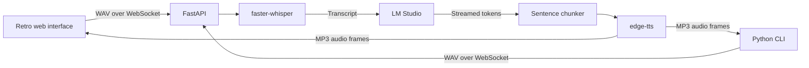

# Local Voice AI Assistant


> **Welcome!** This is a local voice assistant with a retro web interface and a real-time speech pipeline.

This project records speech in your browser or from the command-line client, transcribes it locally with `faster-whisper`, streams a response from LM Studio, and sends each completed sentence to text-to-speech as soon as it is available.

**Privacy note:** Speech recognition and the language model run locally. The configured `edge-tts` voice service requires an internet connection and receives the generated reply text. Do not send sensitive information through the online TTS service.

## Features

- FastAPI backend with a WebSocket audio pipeline.
- Local Whisper `base` model with automatic CUDA detection and CPU `int8` fallback, including CUDA runtime failures during inference.
- Streaming responses from the OpenAI-compatible LM Studio API.
- Sentence-by-sentence speech synthesis with `edge-tts`.
- English assistant replies and English voice by default.
- Retro browser interface with microphone and speaker selection, live status, and an animated audio visualizer.
- Python CLI client for microphone recording and streamed audio playback.

## Architecture



The browser captures mono audio, converts it to 16 kHz WAV, and sends it to `/ws`. The server sends JSON status and transcript events, followed by `audio_start`, binary MP3 frames, and `audio_end` events for each sentence. The response finishes with `response_done`.

## Get started in 3 steps

### 1. Create a virtual environment and install dependencies

Python 3.11 or later is required. From PowerShell in the project folder:

```powershell
py -3.11 -m venv .venv
.\.venv\Scripts\Activate.ps1
python -m pip install --upgrade pip
python -m pip install -r requirements.txt
```

In VS Code, select `.venv\Scripts\python.exe` using **Python: Select Interpreter**. For CUDA acceleration, install the CUDA/cuDNN runtime supported by your CTranslate2 build. Whisper uses CPU when CUDA is not available.

### 2. Start LM Studio and the backend

Load your Qwen model in LM Studio and start its OpenAI-compatible server at `http://localhost:1234/v1`. Set `LLM_MODEL` to the exact model identifier shown by LM Studio:

```powershell
$env:LLM_MODEL = "qwen3.5-9b"
python app.py
```

Replace `qwen3.5-9b` with the exact model identifier displayed in LM Studio. To keep local settings out of Git, copy `.env.example` to `.env` and edit the value there instead:

```powershell
Copy-Item .env.example .env
```

The first run downloads the Whisper model. The application UI is at <http://127.0.0.1:8000/>; API docs are at <http://127.0.0.1:8000/docs>, and the health check is at <http://127.0.0.1:8000/health>.

### 3. Talk to the assistant

Open the browser UI and allow microphone access. Choose an input device and, where supported, an output device. Press **Start talking**, speak, then press **Stop and send**. The status display and animated visualizer show recording, transcription, generation, and playback.

You can also use the CLI:

```powershell
python client.py
```

Press Enter to record. Options include `--duration 6`, `--server ws://127.0.0.1:8000/ws`, and `--device 1`. List audio devices with:

```powershell
python -c "import sounddevice as sd; print(sd.query_devices())"
```

## Configuration

Environment variables or a `.env` file in the backend directory can be used:

| Variable | Default | Description |
|---|---|---|
| `LLM_BASE_URL` | `http://localhost:1234/v1` | OpenAI-compatible LM Studio URL |
| `LLM_API_KEY` | `lm-studio` | API key, if required by the server |
| `LLM_MODEL` | `qwen3.5-9b` | Model identifier loaded in LM Studio |
| `LLM_TIMEOUT_SECONDS` | `90` | LLM request timeout |
| `WHISPER_MODEL` | `base` | Whisper model, such as `base` or `small` |
| `WHISPER_DEVICE` | `auto` | `auto`, `cpu`, or `cuda` |
| `WHISPER_COMPUTE_TYPE` | automatic | For example, `int8` or `float16` |
| `WHISPER_LANGUAGE` | automatic | Optional transcription language code |
| `TTS_VOICE` | `en-US-AriaNeural` | Edge TTS voice |
| `HOST` | `127.0.0.1` | Backend bind address |
| `PORT` | `8000` | Backend port |

The WebSocket endpoint accepts 16 kHz WAV audio and limits uploads to 15 MiB. The web interface needs a browser that supports `getUserMedia` and Web Audio. AudioWorklet is preferred; a ScriptProcessor compatibility fallback is used if its worklet module cannot be loaded. Selecting a specific output device requires browser support for `HTMLMediaElement.setSinkId`; otherwise audio uses the system default.

## Benchmarks

These are goals, not measurements. Actual latency depends on hardware, network conditions, model settings, and the delay before the first complete sentence is generated.

| Metric | Target / behavior | Main factors |
|---|---|---|
| Whisper model load | Once at startup | Model size, disk, CPU/GPU |
| CPU transcription | Hardware-dependent | CPU, model size, recording length |
| CUDA transcription | Aim for faster than real time | GPU, CUDA/cuDNN, recording length |
| Time to first audio | Goal: under 700 ms; not guaranteed | STT, LLM first sentence, TTS, network |
| Response delivery | Audio is sent sentence by sentence | Generation and synthesis speed |

For a meaningful time-to-first-audio measurement, time from the end of recording to the first received MP3 frame. Exclude the one-time Whisper model load.

## Troubleshooting

- **Microphone permission denied:** allow microphone access for `localhost` in browser settings.
- **AudioWorklet module fails to load:** the app checks the worklet asset and falls back to a compatibility recorder. Restart the backend after updating the project files.
- **LM Studio unavailable:** start the local OpenAI-compatible server and verify `LLM_BASE_URL` and `LLM_MODEL`.
- **CUDA runtime error:** if CUDA is detected but its runtime libraries cannot run inference, Whisper logs the failure and retries on CPU with `int8`.
- **No speech recognized:** speak clearly, check the selected microphone, and make sure the recording is not silent.
- **No sound from the selected speakers:** use a browser that supports `setSinkId`, or select the system default output.

## Development

Install the development dependencies and run the automated tests:

```powershell
python -m pip install -r requirements-dev.txt
python -m pytest -q
```

The GitHub Actions workflow runs these tests on Windows with Python 3.11 and 3.12. The tests mock LM Studio and speech synthesis, so they do not need a loaded model, a microphone, or network access.
